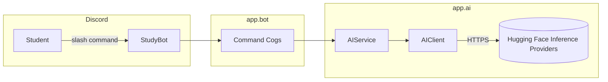

# StudyBot 

A Discord AI study assistant progressively demonstrates: bots & events, calling an LLM API, prompt engineering using a small, readable codebase.

## 1. Project overview

StudyBot lives in Discord. Students can:
- Ask general questions (`/ask`)

## 2. Features

| Command | Description |
|---|---|
| `/start` | Welcome message |
| `/help` | List all commands |
| `/ask <question>` | Ask anything |
| `/status` | Check AI configuration status |

## 3. Architecture diagram



## 4. Tech stack

- Python 3.11+
- `discord.py` (slash commands via `app_commands`)
- **Hugging Face Inference Providers** (free-tier cloud API) for chat/text
  generation — `/ask`
- `pytest` for tests

This entire stack is free to run: Hugging Face's Inference Providers have a free tier with monthly credits.

## 5. Prerequisites

- Python 3.11 or newer
- A Discord account + a Discord server you can add a bot to
- A free Hugging Face account and token (optional for basic bot testing required only for `/ask`)

## 6. Installation (Windows / PowerShell)

```powershell
# From the project root
python -m venv .venv
.venv\Scripts\Activate.ps1
pip install -r requirements.txt
```

macOS/Linux equivalent:

```bash
python3 -m venv .venv
source .venv/bin/activate
pip install -r requirements.txt
```

## 7. Environment variables

Copy `.env.example` to `.env` and fill in the values:

```powershell
Copy-Item .env.example .env
```

```bash
cp .env.example .env   # macOS/Linux
```

| Variable | Purpose |
|---|---|
| `DISCORD_TOKEN` | Your Discord bot token |
| `HF_API_KEY` | Your Hugging Face token, used for chat/text generation |
| `HF_MODEL` | Which model to use on Hugging Face's Inference Providers |


**Never commit your `.env` file.** It contains secrets (your Discord token
and Hugging Face token). Anyone with these could impersonate your bot or use up your Hugging Face free-tier credits. `.gitignore` already excludes `.env` for you.

## 8. Discord bot setup

1. Go to https://discord.com/developers/applications and click **New
   Application**.
2. Under **Bot**, click **Add Bot**, then **Reset Token** and copy it into
   `DISCORD_TOKEN` in your `.env`.
3. Under **Bot → Privileged Gateway Intents**, enable **Message Content
   Intent**.
4. Under **OAuth2 → URL Generator**, select scopes `bot` and
   `applications.commands`, and permissions `Send Messages`,
   `Read Message History`, `Attach Files`. Copy the generated URL.
5. Open that URL in a browser and invite the bot to your test server.

## 9. AI provider setup — Hugging Face (free)

1. Create a free account at https://huggingface.co
2. Go to https://huggingface.co/settings/tokens/new and create a
   **fine-grained** token with the **"Make calls to Inference Providers"**
   permission enabled.
3. Put it in `.env` as `HF_API_KEY`.
4. `HF_MODEL` defaults to `meta-llama/Llama-3.1-8B-Instruct`, a good
   free-tier chat model. You can swap in any chat model listed at
   https://huggingface.co/docs/inference-providers.

Hugging Face's free tier gives monthly inference credits — plenty for a
workshop, but they are not unlimited like the local embedding step below.

If `HF_API_KEY` is missing, the bot still starts and indexing documents
still works (embeddings are local), but `/ask` reply with a friendly configuration message instead of crashing.


## 10. Running the project

```powershell
python -m app.main
```

You should see:

```
StudyBot is online as StudyBot#1234
```

## 11. Testing

```powershell
pytest -q
```

No AI API key or Discord token is required all external calls are mocked
with a `FakeAIClient` in `tests/conftest.py`.

## 12. Manual Testing Checklist

1. **Create the environment**: `python -m venv .venv`
2. **Activate it**: `.venv\Scripts\Activate.ps1`
3. **Install dependencies**: `pip install -r requirements.txt`
4. **Configure `.env`**: copy `.env.example` → `.env`, fill in
   `DISCORD_TOKEN` and `HF_API_KEY`
5. **Start the bot**: `python -m app.main` → expect `StudyBot is online...`
6. **Invite the bot** to your test server using the OAuth2 URL from step 8
   above
7. **Test `/help`**: run it in Discord → expect the command list
8. **Test `/ask`**: `/ask What is a deadlock?` → expect a general AI answer


## 13. checkpoints

| Checkpoint | What it demonstrates | Key files |
|---|---|---|
| Basic Discord bot | Events, slash commands | `app/bot/bot.py`, `app/bot/commands/basic.py` |
| AI-powered bot | Calling an LLM API, prompt engineering | `app/ai/client.py`, `app/ai/prompts.py`, `app/bot/commands/ai_commands.py` |
| Final project | Everything wired together, error handling, tests | whole repo |


## Project structure

```
studybot/
├── app/
│   ├── bot/            # Discord layer (bot, events, command cogs)
│   ├── ai/             # LLM client, prompts, AIService
│   ├── utils/          # Discord message-splitting helper
│   ├── config.py
│   └── main.py
├── tests/              # pytest suite
├── docs/               # architecture.md,discord-bot.md
├── .env.example
├── .gitignore
├── requirements.txt
└── pyproject.toml
```
