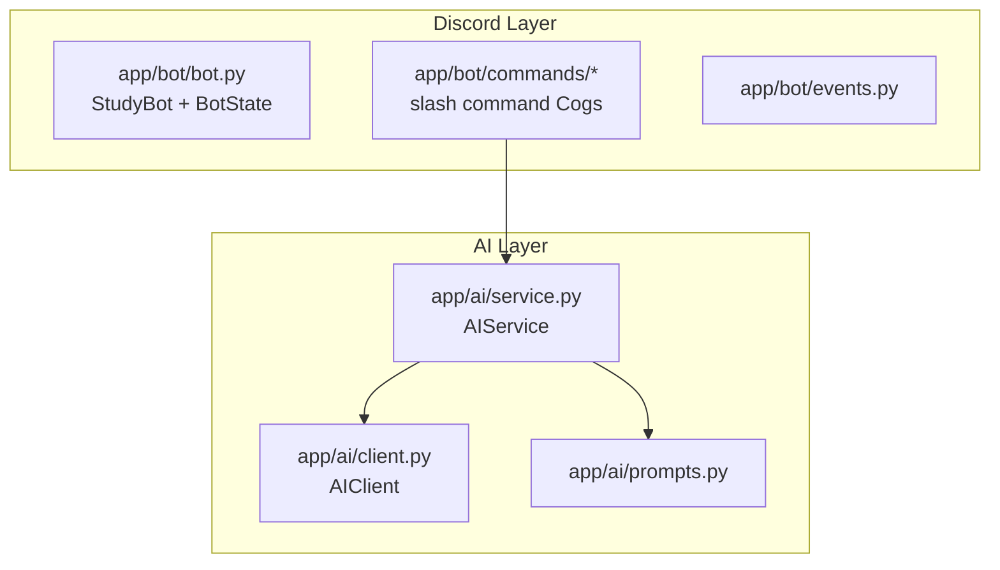

# Architecture

StudyBot is organized in layers, each with a single responsibility.
This separation is what makes the codebase teachable: every file answers
one question.

## Why this shape?

- **`app/bot`** never talks to the LLM or the vector store directly. It
  only calls `AIService` methods. This means you can test
  the AI logic without ever starting Discord.
- **`app/ai`** knows nothing about Discord or PDFs. It turns `question` into text. `AIClient` is the only place that talks to
  the network, which is also the only class that needs mocking in tests.

## BotState

`app/bot/bot.py` builds all shared services once, at startup, inside
`BotState`, and hangs them off `bot.state`. Command Cogs receive `self.bot`and read `self.bot.state.ai_service`.
This avoids global variables while keeping dependency wiring in one visible place.

## Error handling philosophy

- Configuration problems (missing API key, missing Discord token) raise a
  `ConfigError` with a plain-English message, caught at the command level
  and shown to the user without a stack trace.
- Network/provider errors from `AIClient` are wrapped in `RuntimeError` with the underlying message, logged with `logger.exception` (full traceback in your terminal), and surfaced to Discord as a short friendly sentence.

